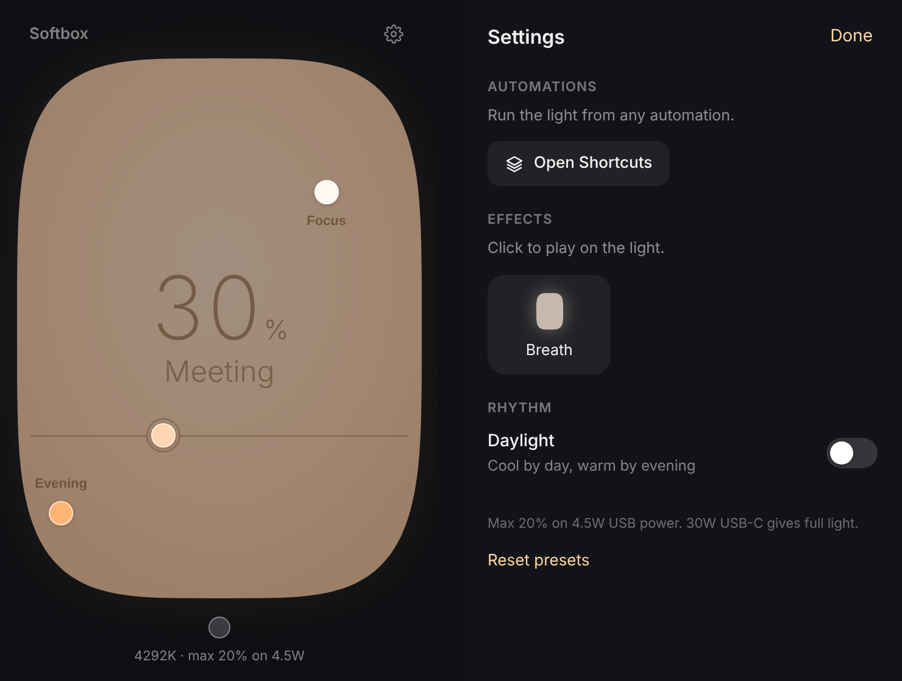

# Softbox

A calm, native controller for the **Elgato Key Light Air MK.2**: a Mac menu-bar app, an iPhone app that talks to the light directly, Shortcuts actions, a gentle "Claude needs you" signal for Claude Code, and an optional web panel.

<p align="center"><a href="https://www.youtube.com/watch?v=-Jyw3JdRxOk"></a><br><sub><a href="https://www.youtube.com/watch?v=-Jyw3JdRxOk">Watch on YouTube</a> · <a href="https://danordanor.github.io/softbox/">Website</a></sub></p>

<p align="center"></p>

The whole light is the control. Left to right is warm to cool, bottom to top is brightness. Tap anywhere to put the light there, drag the line to change only brightness, tap a circle to use a preset.

> Not affiliated with Elgato or Corsair. Softbox is an independent project for people who own the light.

## Why

The MK.2 dropped the open HTTP API the older Key Lights had. It only accepts a **mutually authenticated TLS WebSocket** carrying JSON-RPC, and Elgato's own app is the only thing that speaks it. Softbox speaks it too (see [docs/PROTOCOL.md](docs/PROTOCOL.md)), so you get:

| | |
|---|---|
| **Mac menu bar** | Click the lamp for the panel, right-click for presets. Starts at login. |
| **iPhone app** | Native SwiftUI. Finds the light with Bonjour and controls it directly over Wi-Fi. No Mac needed. |
| **Shortcuts** | *Play Light Effect*, *Use Light Preset*, *Toggle Light*, *Sunrise*, *Wind Down*. Run them from any automation: an email arriving, an alarm, the charger. |
| **Claude Code** | The light breathes softly when Claude needs you or finishes. |
| **Presets** | Drag them anywhere on the light. On iPhone, press and hold to add, rename or delete. |
| **Soft transitions** | Asks the light for slow fades, so on, off and every change glide instead of jump. |
| **Daylight rhythm** | Optional: cool by day, warm by evening. |
| **CLI and local API** | `light on`, `light b 40`, `light focus`, or a `curl`. |
| **Web panel** | Optional, for any browser on your network. |

Brightness is shown 0 to 100 **of what your power supply allows**. On a weak USB port the light caps itself (for example 20% on 4.5 W); Softbox shows the cap and keeps the scale honest. A 30 W USB-C PD charger gives full brightness.

## Requirements

- A Mac with **Elgato Control Center** installed and the light paired once. Softbox mints its client certificate from the one that app ships. Nothing is downloaded and the key never leaves your Mac.
- **Xcode Command Line Tools** for the menu-bar app (`xcode-select --install`), and **Xcode** for the iPhone app.
- The light, the Mac and the phone on the same Wi-Fi.

## Install on the Mac

One line, in Terminal:

```sh
curl -fsSL https://github.com/danordanor/softbox/releases/latest/download/get.sh | bash
```

You need the **Elgato Control Center** app (paired with your light once, Softbox borrows its certificate) and Apple's **Command Line Tools** (`xcode-select --install`, for Python).

This mints the certificate into `~/.softbox`, installs the background service (`lightd`) as a LaunchAgent, puts the signed **Softbox.app** into `~/Applications`, and the lamp in your menu bar, now and at login. Add `-s -- --web` for the browser panel or `-s -- --no-hooks` to skip Claude Code, e.g. `… | bash -s -- --no-hooks`.

**Updating:** run the same line again. Every [release](https://github.com/danordanor/softbox/releases) is listed with what changed.

The light is found automatically with Bonjour. If yours isn't, put its address in `~/.softbox/config.json`:

```json
{ "hosts": ["elgato-key-light-air-mk-2-xxxx.local"] }
```

<details>
<summary>From source</summary>

```sh
git clone https://github.com/danordanor/softbox.git
cd softbox/mac
./install.sh            # add --web for the browser panel, --no-hooks to skip Claude Code
```

This builds Softbox.app on your Mac. Update with `git pull && ./update.sh`. The service restarts in place, and the menu-bar app rebuilds itself when its code changes.
</details>

## Install on the iPhone

```sh
cd softbox/ios
./make-identity.sh      # packs your certificate into Softbox/Softbox.p12 (stays local)
open Softbox.xcodeproj
```

In Xcode: select the **Softbox** target, go to **Signing & Capabilities**, pick your **Team** (a free Apple ID works), and change the **Bundle Identifier** to something unique like `com.yourname.softbox`. Plug in your iPhone and press ▶.

On first launch, trust the developer under *Settings → General → VPN & Device Management*, and allow **Local Network**. With a free Apple ID the app needs a fresh ▶ every 7 days; a paid developer account lasts a year.

Then open **Shortcuts → Automation → +**, pick a trigger, and add a Softbox action.

## Web panel (optional)

```sh
./install.sh --web
```

Open `http://<your-mac>.local:9124` on any device on your network. Without `--web` the panel only opens inside the menu-bar app.

## Claude Code

The installer adds two hooks to `~/.claude/settings.json`:

| When | The light |
|---|---|
| Claude asks for input or approval | three soft breaths |
| Claude finishes a turn | three soft breaths |

The breath is one gentle effect: the light rises 10% of what the power allows and settles back, three times, each glide about a second. Brightness only, never the colour. The light does the gliding itself (its fade is lengthened for the effect and restored after), so nothing steps or jumps. Remove the hooks with `python3 ~/.softbox/hooks_install.py --remove`.

## CLI and local API

```sh
light on | off | toggle
light b 40              # brightness, 0-100
light warm | cool | day
light focus | meeting | evening
light breath            # play the effect
```

Everything goes through a small local API on port 9124. POST requests need the `X-Lightd: 1` header, which keeps stray web pages out.

```sh
curl -s -X POST -H "X-Lightd: 1" http://127.0.0.1:9124/api/event/focus
curl -s -X POST -H "X-Lightd: 1" -d '{"on":1,"brightness":40,"kelvin":4500}' http://127.0.0.1:9124/api/set
curl -s http://127.0.0.1:9124/api/state
```

## How it works

```
iPhone app ──── mTLS WebSocket ────┐
                                   ├──▶  Key Light Air MK.2  (wss://light:9123)
Mac: lightd ── mTLS WebSocket ─────┘
  ├─ local API + panel  :9124 ◀── menu-bar app (WKWebView), CLI, Claude Code hooks, curl
  └─ Bonjour _softbox._tcp  ◀── iPhone app reads Mac-only settings (daylight)
```

- `lightd` keeps **one** connection open (the firmware dislikes many in a row) and paces requests.
- Effects run where they're started: on the phone from the iPhone app, in `lightd` from the Mac.
- Your presets live on each device.

## Repository

```
mac/
  lightd.py             background service: TLS WebSocket ⇄ local API + panel
  ui.html               the panel
  app/                  the menu-bar app (Swift, built with swiftc)
  install.sh            set everything up       update.sh   refresh in place
  uninstall.sh          remove (keeps the certificate unless --all)
  light                 the CLI
  hooks_install.py      Claude Code hooks
ios/
  Softbox.xcodeproj     the iPhone app
  Softbox/              SwiftUI views, light controller, Shortcuts actions
  make-identity.sh      builds the app's client identity from your certificate
test/mocklight.py       a stand-in light for working without hardware
docs/PROTOCOL.md        what the MK.2 speaks
```

To work without the light, run `python3 test/mocklight.py`, put `{"hosts": ["127.0.0.1"]}` in a test config, and start `LIGHTD_HOME=/tmp/sb LIGHTD_WEB=1 python3 mac/lightd.py`.

## Security

Your client certificate lives in `~/.softbox` (`client.key`, `client-chain.crt`) and, for the iPhone build, in `ios/Softbox/Softbox.p12`. All of them are git-ignored. **Never commit or share them.** They're derived from a key inside Elgato Control Center, which is why each user makes their own and none ships with this repo.

## Uninstall

```sh
~/.softbox/uninstall.sh          # keeps the certificate
~/.softbox/uninstall.sh --all    # removes everything
```

## License

MIT. See [LICENSE](LICENSE). Elgato and Key Light are trademarks of Corsair; they're used here only to say which light this works with.
